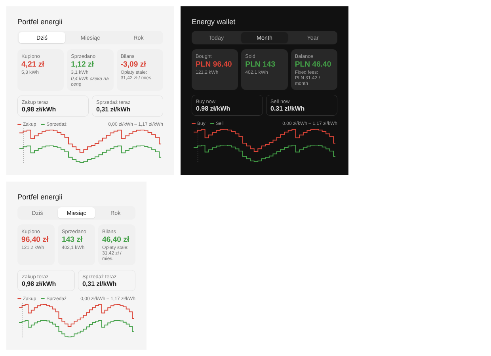

# Energy Wallet for Home Assistant

Integracja i karta pokazujące, **za ile kupiłeś energię z sieci i za ile ją sprzedałeś**. Każda kWh jest wyceniana po cenie z chwili, w której przepłynęła przez licznik: cena dynamiczna albo strefa taryfy G11/G12/G12w przy zakupie, RCE z PSE przy sprzedaży (net-billing).



*English summary at the bottom.*

## Co robi

- Czyta dwa **narastające liczniki energii** (pobór z sieci i oddanie do sieci) z dowolnego falownika lub licznika, np. Deye `TotalEnergyBuy` / `TotalEnergySell`.
- Pobiera **RCE z API PSE** (`api.raporty.pse.pl`, okresy 15-minutowe, ceny na jutro zwykle po ok. 14:00).
- Przypisuje każdy przyrost energii do 15-minutowego okresu i wycenia go:
  - **zakup** = (cena energii + zmienne opłaty dystrybucyjne) × (1 + VAT).
    - Taryfa stała: cena zależy od strefy (G11 / G12 / G12w, z weekendami i świętami).
    - Taryfa dynamiczna: cena energii = RCE + marża sprzedawcy.
  - **sprzedaż** = RCE okresu (ujemne liczone jako 0, opcjonalnie), albo RCEm (średnia miesięczna).
- Wystawia sensory dla okresów *dziś / miesiąc / rok*, sumy całkowite, aktualne ceny i prognozę cen. Dorzuca do tego kartę Lovelace.

Dlaczego jedno źródło cen wystarcza na obie strony: od 14.06.2024 RCE to cena z jednolitego łączenia rynków dnia następnego (SDAC) dla Polski, czyli ta sama cena co Fixing I na TGE, do którego są indeksowane oferty dynamiczne.

## Instalacja

1. HACS → *Custom repositories* → `https://github.com/gratak/ha-energy-wallet`, kategoria *Integration*.
2. Zainstaluj **Energy Wallet** i zrestartuj Home Assistant.
3. *Ustawienia → Urządzenia i usługi → Dodaj integrację → Energy Wallet*.

Karta rejestruje się sama. W edytorze dashboardu dodaj kartę „Energy Wallet” albo wpisz YAML:

```yaml
type: custom:energy-wallet-card
period: today        # today | month | year
show_chart: true
# title: Mój portfel
# entry_id: ...      # tylko gdy masz kilka portfeli
```

## Konfiguracja

1. **Liczniki.** Integracja podpowiada encje: najpierw z ustawień Energy Dashboard (sieć: pobór i oddanie), a jeśli ich tam nie ma, zgaduje po nazwach (`buy/import/purchase` oraz `sell/export/feed-in`). Liczniki dzienne, miesięczne i chmurowe (`station`) są pomijane.
2. **Sprzedawca i taryfa.** Wybierasz sprzedawcę, grupę taryfową (G11/G12/G12w), cenę dynamiczną, dystrybutora (OSD), liczbę faz i sposób rozliczenia sprzedaży (RCE albo RCEm).
3. **Ceny.** Pola są wypełnione danymi z `tariffs/<rok>.json`, jeśli integracja je ma. Puste pola trzeba przepisać z umowy lub taryfy. Wszystkie ceny wpisujesz **netto**:
   - *zmienne opłaty dystrybucyjne* = opłata sieciowa zmienna + jakościowa + OZE + kogeneracyjna (zł/kWh),
   - *opłaty stałe* = handlowa + sieciowa stała + abonamentowa + mocowa + przejściowa (zł/mies.). Są pokazywane osobno i nie wchodzą do bilansu.

Wszystko da się później zmienić w opcjach integracji. Zmiana taryfy czyści stare ceny, żeby nie zostały przypadkiem.

### Dane taryf: stan

| Dane | Źródło | Stan |
|---|---|---|
| RCE / ceny dynamiczne | API PSE | automatycznie |
| Ceny energii G11 2026 (Tauron, PGE, Enea, Energa) | artykuły prasowe o taryfach URE | ⚠️ niezweryfikowane z PDF |
| Opłata sieciowa stała Tauron Dystrybucja i PGE Dystrybucja G11 | artykuły prasowe | ⚠️ niezweryfikowane |
| Pozostałe stawki dystrybucyjne, G12/G12w, marże ofert dynamicznych | — | brak, trzeba wpisać ręcznie |

Taryfy sprzedawców i OSD są publikowane wyłącznie jako PDF-y, bez API. Każda wartość w `tariffs/2026.json` ma pole `sources` i flagę `verified`. **PR-y z danymi z oficjalnych taryf są bardzo mile widziane.** Gdy wbudowane dane są z poprzedniego roku, integracja zgłasza ostrzeżenie w *Naprawach*.

### RCEm

W trybie RCEm przychód jest szacowany jako średnia z dziennych średnich RCE w danym miesiącu. Oficjalną wartość, gdy PSE ją opublikuje, możesz ustawić usługą:

```yaml
action: energy_wallet.set_rcem
data:
  month: "2026-09"
  price: 0.2871   # zł/kWh; pomiń, aby wrócić do szacunku
```

## Sensory

| Sensor | Opis |
|---|---|
| `Koszt zakupu dziś / w tym miesiącu / w tym roku / łącznie` | zł brutto; atrybut `energy_kwh` |
| `Przychód ze sprzedaży …` | zł; atrybut `energy_kwh`, `sale_mode` |
| `Bilans …` | przychód − koszt; atrybut `fixed_monthly_gross` |
| `Aktualna cena zakupu` | zł/kWh brutto; atrybut `forecast` (zakup i sprzedaż na kolejne okresy) |
| `Aktualna cena sprzedaży` | zł/kWh |

`Aktualną cenę zakupu` i `sprzedaży` możesz też podpiąć w Energy Dashboard jako cenę dla poboru i rekompensaty za oddanie.

## Ograniczenia i uwagi

- **Liczniki falownika ≠ licznik operatora.** Licznik OSD bilansuje fazy wektorowo, falownik i przekładniki mogą liczyć inaczej. Traktuj wynik jako dobre przybliżenie faktury, nie jej kopię.
- **Rozdzielczość licznika.** Deye podaje 0,1 kWh, więc pojedynczy kwadrans potrafi „schodkować”. W skali dnia i miesiąca to się wyrównuje.
- **Spadki licznika.** Dla `state_class: total` spadek jest traktowany jako chwilowy błąd i energia liczy się dopiero ponad najwyższą widzianą wartością, żeby falownik raportujący na moment 0 nie dublował energii. Dla `total_increasing` spadek oznacza reset licznika. Skoki nierealne fizycznie (domyślnie powyżej 50 kW średnio) są odrzucane.
- **Brak ceny.** Energia czeka na cenę (np. gdy PSE nie odpowiada) do 3 dni. Potem jest liczona jako `unpriced_kwh`.
- Rozliczenie godzinowe kontra 15-minutowe: integracja wycenia po okresach publikowanych przez PSE. Jeśli Twój sprzedawca rozlicza się inaczej, mogą być drobne różnice.

## Rozwój

```bash
python -m venv .venv && . .venv/bin/activate
pip install -r requirements_test.txt
pytest -q
```

Logika (`tariff.py`, `wallet.py`, `pse.py`, `detect.py`) nie zależy od Home Assistanta i ma własne testy. `tests/test_integration.py` uruchamia całość w prawdziwej instancji HA.

---

## English

Home Assistant integration and card showing **what grid energy cost you and what your exports earned** in Poland. It reads cumulative grid import/export counters from any inverter or meter, prices each 15-minute slot with PSE RCE (sale and dynamic tariffs) or fixed G11/G12/G12w zone prices plus distribution charges, and exposes today/month/year cost, revenue and balance sensors plus a Lovelace card. Tariff data for Polish sellers and DSOs is bundled where known (`tariffs/<year>.json`, flagged as unverified) and asked for in the config flow otherwise. Contributions of verified tariff data are welcome.

License: MIT.
