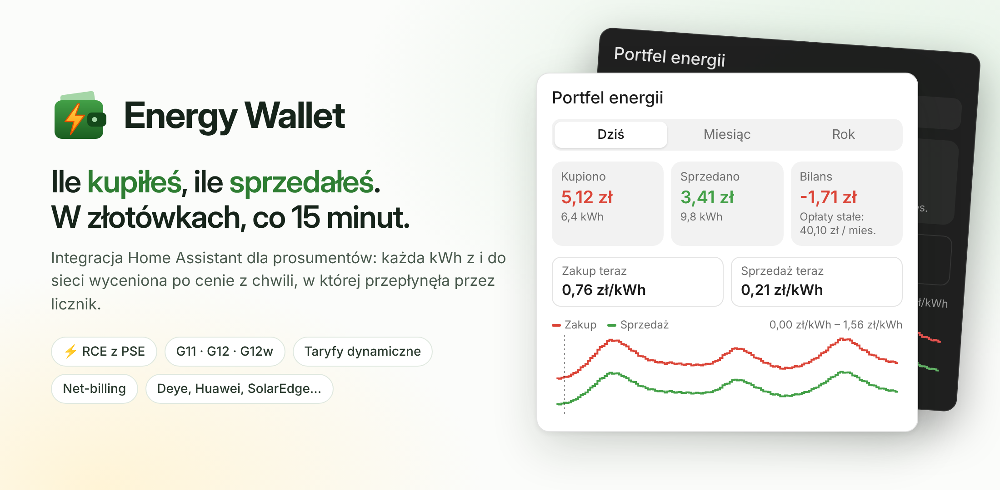
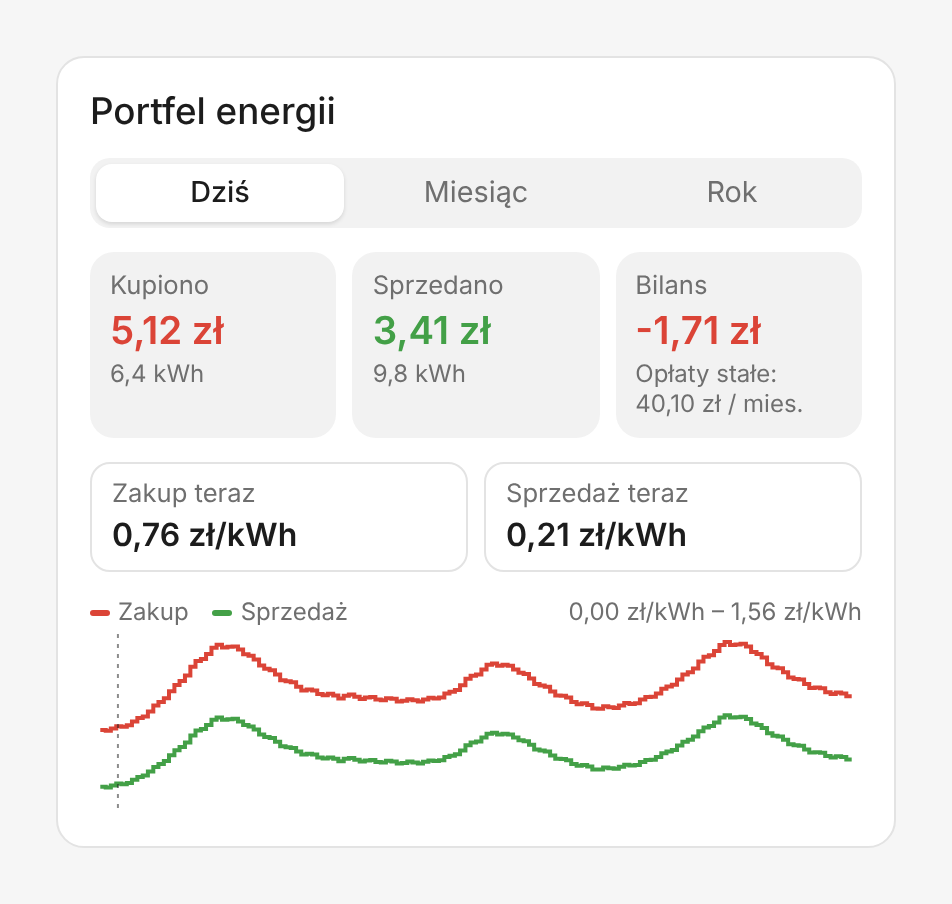
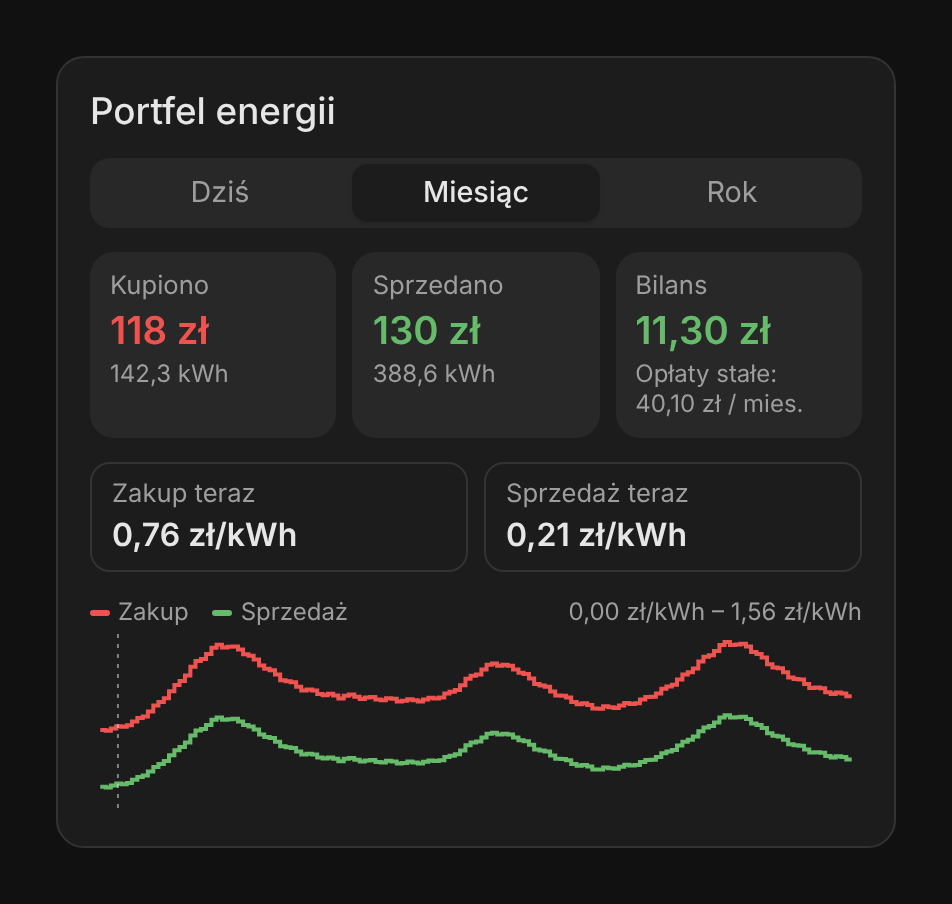

# Energy Wallet for Home Assistant



Integracja i karta pokazujące, **za ile kupiłeś energię z sieci i za ile ją sprzedałeś**. Każda kWh jest wyceniana po cenie z chwili, w której przepłynęła przez licznik: cena dynamiczna albo strefa taryfy G11/G12/G12w przy zakupie, RCE z PSE przy sprzedaży (net-billing).

<p>
  
  
</p>

*English summary at the bottom.*

## Co robi

- Czyta dwa **narastające liczniki energii** (pobór z sieci i oddanie do sieci) z dowolnego falownika lub licznika, np. Deye `TotalEnergyBuy` / `TotalEnergySell`.
- Pobiera **RCE z API PSE** (`api.raporty.pse.pl`, okresy 15-minutowe, ceny na jutro zwykle po ok. 14:00).
- Przypisuje każdy przyrost energii do 15-minutowego okresu i wycenia go:
  - **zakup** = (cena energii + akcyza + zmienne opłaty dystrybucyjne) × (1 + VAT).
    - Taryfa stała: cena zależy od strefy (G11 / G12 / G12w, z weekendami i świętami).
    - Taryfa dynamiczna: cena energii = RCE + marża sprzedawcy.
  - **sprzedaż** = RCE okresu (ujemne liczone jako 0, opcjonalnie), albo RCEm (średnia miesięczna).
- Wystawia sensory dla okresów *dziś / miesiąc / rok*, sumy całkowite, aktualne ceny i prognozę cen. Dorzuca do tego kartę Lovelace.

Dlaczego jedno źródło cen wystarcza na obie strony: od 14.06.2024 RCE to cena z jednolitego łączenia rynków dnia następnego (SDAC) dla Polski, czyli ta sama cena co Fixing I na TGE, do którego są indeksowane oferty dynamiczne.

## Instalacja

1. HACS → *Custom repositories* → `https://github.com/gratak/ha-energy-wallet`, kategoria *Integration*.
2. Zainstaluj **Energy Wallet** i zrestartuj Home Assistant.
3. *Ustawienia → Urządzenia i usługi → Dodaj integrację → Energy Wallet*.

Karta rejestruje się sama. W edytorze dashboardu dodaj kartę „Energy Wallet” albo wpisz YAML:

```yaml
type: custom:energy-wallet-card
period: today        # today | month | year
show_chart: true
# title: Mój portfel
# entry_id: ...      # tylko gdy masz kilka portfeli
```

## Konfiguracja

1. **Liczniki.** Integracja podpowiada encje: najpierw z ustawień Energy Dashboard (sieć: pobór i oddanie), a jeśli ich tam nie ma, zgaduje po nazwach (`buy/import/purchase` oraz `sell/export/feed-in`). Liczniki dzienne, miesięczne i chmurowe (`station`) są pomijane.
2. **Sprzedawca i taryfa.** Wybierasz sprzedawcę, grupę taryfową (G11/G12/G12w), cenę dynamiczną, dystrybutora (OSD), liczbę faz i sposób rozliczenia sprzedaży (RCE albo RCEm).
3. **Ceny.** Pola są wypełnione danymi z `tariffs/<rok>.json`, jeśli integracja je ma. Puste pola trzeba przepisać z umowy lub taryfy. Wszystkie ceny wpisujesz **netto**:
   - *zmienne opłaty dystrybucyjne* = opłata sieciowa zmienna + jakościowa + OZE + kogeneracyjna (zł/kWh),
   - *opłaty stałe* = handlowa + sieciowa stała + abonamentowa + mocowa (według wybranego progu zużycia) + przejściowa (zł/mies.). Są pokazywane osobno i nie wchodzą do bilansu.
   - PGE Dystrybucja przesuwa latem (kwiecień–wrzesień) popołudniową strefę tańszą na 15–17; służy do tego pole *godziny strefy tańszej latem*.

Wszystko da się później zmienić w opcjach integracji. Zmiana taryfy czyści stare ceny, żeby nie zostały przypadkiem.

### Dane taryf: stan

Stan na 14.10.2026 (`tariffs/2026.json`, ceny netto):

| | G11 | G12 | G12w | Strefy | Opłaty stałe |
|---|---|---|---|---|---|
| **TAURON Dystrybucja** | ✅ | ✅ | ✅ | 13–15, 22–6 | ✅ |
| **PGE Dystrybucja** | ✅ | ✅ | ✅ | zima 13–15, lato 15–17; 22–6 | ✅ |
| **Enea Operator** | ✅ | ✅ | ✅ | G12: 13–15, 22–6 ⚠️; G12w: 21–6 | bez abonamentowej |
| **Energa Operator** | ✅ | ✅ | ✅ | 13–15, 22–6 | częściowo |
| **Stoen Operator** | ✅ | ✅ | — | 22–6 | częściowo |
| **Sprzedawcy z urzędu** (Tauron, PGE, Enea, Energa) | ✅ | ✅ | ✅ | | opłata handlowa: Tauron/PGE 0 zł |
| **Oferty dynamiczne** (marża, opłata) | Tauron, PGE, Enea, Energa | | | | ✅ |
| **E.ON** | — (ceny spoza taryfy URE) | | | | |

Wspólne dla wszystkich: opłata jakościowa 0,0332, OZE 0,0073, kogeneracyjna 0,0030 zł/kWh, akcyza 0,005 zł/kWh, opłata mocowa według progu rocznego zużycia (4,29 / 10,31 / 17,18 / 24,05 zł/mies.).

Skąd te dane: z wyciągów taryf OSD, taryf sprzedawców zatwierdzonych przez URE (17.12.2025) i serwisów branżowych. Większość stawek sprawdzono krzyżowo: netto × 1,23 daje co do grosza brutto z drugiego źródła, a dla cen energii (netto + akcyza) × 1,23 daje brutto. **Nikt jednak nie porównał ich jeszcze ręcznie z PDF-em**, dlatego wszystkie mają `"verified": false`, a konfiguracja pokazuje ⚠️. Każdy wpis ma `sources` i `note`. Najsłabsze dane to marże ofert dynamicznych (tabele porównawcze z początku 2026) i godziny stref Enei. Puste pola (`null`) konfiguracja każe wpisać ręcznie.

**PR-y z poprawkami i weryfikacją według oficjalnych taryf są bardzo mile widziane.** Gdy wbudowane dane są z poprzedniego roku, integracja zgłasza ostrzeżenie w *Naprawach*.

### RCEm

W trybie RCEm przychód jest szacowany jako średnia z dziennych średnich RCE w danym miesiącu. Oficjalną wartość, gdy PSE ją opublikuje, możesz ustawić usługą:

```yaml
action: energy_wallet.set_rcem
data:
  month: "2026-09"
  price: 0.2871   # zł/kWh; pomiń, aby wrócić do szacunku
```

## Sensory

| Sensor | Opis |
|---|---|
| `Koszt zakupu dziś / w tym miesiącu / w tym roku / łącznie` | zł brutto; atrybut `energy_kwh` |
| `Przychód ze sprzedaży …` | zł; atrybut `energy_kwh`, `sale_mode` |
| `Bilans …` | przychód − koszt; atrybut `fixed_monthly_gross` |
| `Aktualna cena zakupu` | zł/kWh brutto; atrybut `forecast` (zakup i sprzedaż na kolejne okresy) |
| `Aktualna cena sprzedaży` | zł/kWh |

`Aktualną cenę zakupu` i `sprzedaży` możesz też podpiąć w Energy Dashboard jako cenę dla poboru i rekompensaty za oddanie.

## Ograniczenia i uwagi

- **Liczniki falownika ≠ licznik operatora.** Licznik OSD bilansuje fazy wektorowo, falownik i przekładniki mogą liczyć inaczej. Traktuj wynik jako dobre przybliżenie faktury, nie jej kopię.
- **Rozdzielczość licznika.** Deye podaje 0,1 kWh, więc pojedynczy kwadrans potrafi „schodkować”. W skali dnia i miesiąca to się wyrównuje.
- **Spadki licznika.** Dla `state_class: total` spadek jest traktowany jako chwilowy błąd i energia liczy się dopiero ponad najwyższą widzianą wartością, żeby falownik raportujący na moment 0 nie dublował energii. Dla `total_increasing` spadek oznacza reset licznika. Skoki nierealne fizycznie (domyślnie powyżej 50 kW średnio) są odrzucane.
- **Brak ceny.** Energia czeka na cenę (np. gdy PSE nie odpowiada) do 3 dni. Potem jest liczona jako `unpriced_kwh`.
- Rozliczenie godzinowe kontra 15-minutowe: integracja wycenia po okresach publikowanych przez PSE. Jeśli Twój sprzedawca rozlicza się inaczej, mogą być drobne różnice.

## Plan rozwoju

Główny cel: **stawki aktualizują się same**, bez czekania na nową wersję integracji i bez polegania na tym, że ktoś je ręcznie przepisze.

### 1. Katalog stawek z historią i pobieraniem z repo

- [ ] Każda stawka w katalogu ma okres obowiązywania (`valid_from` / `valid_to`), a katalog trzyma historię zamiast samych bieżących wartości. Nowa taryfa przełącza się dokładnie o północy w dniu wejścia w życie, choć URE zatwierdza ją już w grudniu.
- [ ] Integracja raz dziennie pobiera aktualny katalog z repozytorium. Wbudowany plik zostaje jako zapas na wypadek braku internetu. Katalog ma numer rewizji, a wybierana jest nowsza z dwóch wersji.
- [ ] Wartości wpisane ręcznie przez użytkownika zawsze wygrywają z katalogiem. Integracja zapamiętuje, które pola zostały nadpisane, a automatyczną aktualizację da się wyłączyć jednym przełącznikiem.
- [ ] Powiadomienie w HA o każdej zmianie stawki, np. „Opłaty dystrybucyjne (dzień): 0,2899 → 0,2950 zł/kWh”.
- [ ] Zmiana stawki działa od momentu jej wejścia w życie. Kwoty już policzone się nie zmieniają.

### 2. Automat aktualizujący katalog (GitHub Actions)

Zaplanowane zadanie w repozytorium robi to, co dziś trzeba robić ręcznie. Jedno centralne miejsce jest stabilniejsze niż parsowanie PDF-ów w każdej instalacji HA.

- [ ] **Strażnik (codziennie).** Sprawdza znane adresy stron taryf OSD i sprzedawców (ETag, Last-Modified, hash pliku, nowe linki do PDF-ów). Gdy nic się nie zmieniło, kończy pracę.
- [ ] **Ekstrakcja (tylko po zmianie).** Pobiera dokument i wyciąga tabele stawek oraz datę „obowiązuje od”:
  - najpierw deterministyczny parser dopasowany do danego dokumentu,
  - gdy parser zawiedzie (operator zmienił układ PDF-a), model językowy wypełnia ściśle określony schemat JSON. Wymaga klucza API zapisanego jako sekret repozytorium.
- [ ] **Automatyczna weryfikacja,** zastępująca sprawdzanie przez ludzi:
  - dwa niezależne dokumenty tego samego OSD: wyciąg netto × 1,23 musi dać co do grosza stawki z informacji o cenach brutto,
  - ceny energii: (netto + akcyza) × 1,23 musi dać cenę brutto z cennika,
  - kontrole zdrowego rozsądku: dopuszczalne zakresy (np. stawka zmienna 0,02–0,8 zł/kWh), zmiana rok do roku nie większa niż ±40%, komplet stref, godziny pokrywające całą dobę,
  - data wejścia w życie zgodna z decyzją URE.
- [ ] **Publikacja.** Gdy wszystkie kontrole przechodzą, automat sam zatwierdza nowy katalog z podbitą rewizją. Gdy któraś nie przechodzi, stary katalog zostaje, a automat zakłada zgłoszenie (issue) z opisem rozbieżności. To jedyny przypadek wymagający człowieka.
- [ ] Zakres na start: 5 OSD (TAURON Dystrybucja, PGE Dystrybucja, Enea Operator, Energa Operator, Stoen Operator) i 4 sprzedawców z urzędu (TAURON, PGE, Enea, Energa). Te źródła da się zweryfikować krzyżowo i pokrywają większość użytkowników.

### 3. Śledzenie decyzji URE

- [ ] Monitorowanie listy decyzji taryfowych URE (BIP / Biuletyn Branżowy) jako dodatkowego sygnału, że trzeba sprawdzić dokumenty operatora. Wyłapuje to także korekty w trakcie roku, np. zmianę opłaty jakościowej od 1 lutego.
- [ ] Opłaty ogólnokrajowe (jakościowa, OZE, kogeneracyjna, mocowa, akcyza) pobierane z komunikatów URE i PSE.

### 4. Oferty dynamiczne i rynkowe

- [ ] Śledzenie cenników ofert dynamicznych (marża, opłata miesięczna). Są mniej pewne niż taryfy URE: zmieniają się bez decyzji regulatora, mają nieregularny układ i nie istnieje drugi dokument do porównania.
- [ ] Dla sprzedawców z publicznym API (np. Pstryk) cena zakupu pobierana bezpośrednio od nich zamiast wyliczania jej z RCE.

### 5. Import faktury

- [ ] Użytkownik wgrywa PDF faktury (albo przekazuje e-fakturę mailem), a integracja odczytuje stawki faktycznie mu naliczone i ustawia je jako jego wartości. To najdokładniejsze źródło dla umów niestandardowych: promocji, gwarancji ceny, innych okresów rozliczeniowych.

### Inne

- [ ] Przeliczanie wstecz dni sprzed instalacji na podstawie historii liczników z recordera HA. Wymaga stawek z historią dat (punkt 1).
- [ ] Ikona w HACS przez repozytorium `home-assistant/brands`, jeśli HACS nie odczyta folderu `brand/`.

## Rozwój

```bash
python -m venv .venv && . .venv/bin/activate
pip install -r requirements_test.txt
pytest -q
```

Logika (`tariff.py`, `wallet.py`, `pse.py`, `detect.py`) nie zależy od Home Assistanta i ma własne testy. `tests/test_integration.py` uruchamia całość w prawdziwej instancji HA.

---

## English

Home Assistant integration and card showing **what grid energy cost you and what your exports earned** in Poland. It reads cumulative grid import/export counters from any inverter or meter, prices each 15-minute slot with PSE RCE (sale and dynamic tariffs) or fixed G11/G12/G12w zone prices plus distribution charges, and exposes today/month/year cost, revenue and balance sensors plus a Lovelace card. Tariff data for Polish sellers and DSOs is bundled where known (`tariffs/<year>.json`, flagged as unverified) and asked for in the config flow otherwise. Contributions of verified tariff data are welcome.

License: MIT.
